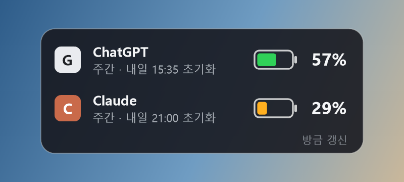

# AI 사용량 위젯 (ChatGPT · Claude)

Windows 바탕화면에서 ChatGPT와 Claude 구독 사용량이 얼마나 남았는지 휴대폰 배터리처럼 보여주는 작은 위젯입니다.

> 비공식 도구입니다. OpenAI, Anthropic과 관련이 없으며 두 회사가 만들거나 보증한 것이 아닙니다. ChatGPT와 Claude는 각 회사의 상표입니다.



## 기능

- 서비스별 남은 사용량(%)을 배터리 모양으로 표시 (50% 이상 초록, 20~49% 주황, 20% 미만 빨강)
- 한도가 여러 개면 먼저 바닥나는 한도를 기준으로 표시하고 초기화 시각을 함께 표시
- 2분마다 자동 갱신, 클릭하면 바로 갱신
- 마우스를 올리면 한도별 사용률, 초기화 시각, 크레딧 같은 자세한 값 표시
- 평소에는 바탕화면에 붙어 다른 창 아래에 깔리고, 원하면 항상 위에 표시
- 끌어서 위치 이동, Windows 시작 시 자동 실행 선택 가능

## 요구 사항

- Windows 10 또는 11 (64비트)
- .NET Framework 4.8 (Windows에 기본 포함)
- Microsoft Edge WebView2 런타임 (대부분의 Windows에 이미 설치되어 있음)
- 각 서비스의 사용량 화면에 사용 한도가 표시되는 ChatGPT 또는 Claude 계정

## 설치

1. 이 저장소를 내려받습니다. (초록색 Code 버튼 → Download ZIP → 압축 풀기, 또는 git clone)
2. 압축을 푼 폴더에서 PowerShell을 열고 아래 명령을 실행합니다.

   ```powershell
   powershell -ExecutionPolicy Bypass -File src\build.ps1
   ```

   처음 한 번은 Microsoft WebView2 SDK를 NuGet에서 내려받은 뒤 `AiUsageWidget.exe`를 만듭니다.
3. `AiUsageWidget.exe`를 실행합니다. 주 모니터 오른쪽 위에 위젯이 나타납니다.

## 처음 실행과 로그인

- 처음에는 두 줄 모두 `로그인 필요`로 보입니다. 그 줄을 클릭하면 로그인 창이 열립니다.
- 위젯은 자체 미니 브라우저(WebView2)로 로그인합니다. 구글 계정 로그인은 내장 브라우저에서 막힐 수 있으니 이메일 인증 코드나 링크로 로그인하세요.
- 로그인이 끝나면 창이 저절로 닫히고 숫자가 표시됩니다.

## 사용법

| 동작 | 결과 |
|---|---|
| 클릭 | 바로 새로고침 (로그인 필요 줄은 로그인 창 열기) |
| 더블클릭 | 그 서비스의 공식 사용량 화면 열기 |
| 끌기 | 위치 이동 (위치 기억) |
| 마우스 올리기 | 한도별 사용률, 초기화 시각, 크레딧 표시 |
| 우클릭 | 새로고침, 공식 화면 열기, 다시 로그인, 항상 위에 표시, Windows 시작 시 자동 실행, 위치 초기화, 종료 |

## 로그인 정보와 개인정보

- 로그인 정보는 실행 파일 옆 `data\webview` 폴더에만 저장됩니다 (Windows 사용자 계정 기준으로 암호화). 이 폴더는 다른 사람과 공유하거나 인터넷에 올리지 마세요.
- 로그인 토큰은 각 서비스 페이지 안에서만 쓰이고, 위젯은 사용량 숫자만 꺼내 `data\state.json`에 저장합니다. 위젯이 따로 외부 서버로 보내는 데이터는 없습니다.
- `data` 폴더를 지우면 로그인부터 다시 해야 합니다.

## 동작 방식

각 서비스의 공식 사용량 화면이 쓰는 데이터를 같은 방식으로 읽습니다.

- ChatGPT: `chatgpt.com/backend-api/wham/usage` (공식 화면 `chatgpt.com/settings/usage`). Codex, Work 등이 함께 쓰는 플랜 한도이며 일반 Chat 대화는 포함되지 않습니다.
- Claude: `claude.ai/api/organizations/(조직 ID)/usage` (공식 화면 `claude.ai/settings/usage`)

## 주의

- 공개 API가 아니므로 서비스가 화면이나 데이터를 바꾸면 동작하지 않을 수 있습니다.
- 각 서비스 약관에는 자동화된 접근을 제한하는 조항이 있습니다. 약관을 확인하고 본인 판단으로 사용하세요. 이 도구를 사용해 생기는 문제에 대해 작성자는 책임지지 않습니다.
- 서비스 로고는 저장소에 넣지 않았고, 기본으로 글자 배지(G, C)를 표시합니다. `assets` 폴더에 `chatgpt.png`, `claude.png`(정사각형 PNG)를 넣으면 그 그림을 대신 표시합니다. 그림의 이용 조건은 직접 확인하세요.

## 제거

우클릭 메뉴에서 `Windows 시작 시 자동 실행`을 끄고 `종료`한 뒤 폴더를 지우면 됩니다.

## 만든 방법

AI 에이전트(Aside)와 함께 만들었습니다.

## 라이선스

MIT

---

## English summary

An unofficial Windows desktop widget that shows how much of your ChatGPT (Codex/Work plan limit) and Claude subscription usage is left, like a phone battery. Not affiliated with or endorsed by OpenAI or Anthropic.

1. Build: `powershell -ExecutionPolicy Bypass -File src\build.ps1` (downloads the Microsoft WebView2 SDK from NuGet on first run)
2. Run `AiUsageWidget.exe` and click a row to sign in (email code sign-in is recommended; Google sign-in may be blocked inside embedded browsers)
3. Sign-in data stays in the local `data\webview` folder and is never uploaded. The widget only stores the usage numbers in `data\state.json`.

It reads the same internal data the official usage pages use, so it may stop working if those pages change. Check each service's terms before use. No logos are included. MIT License.
